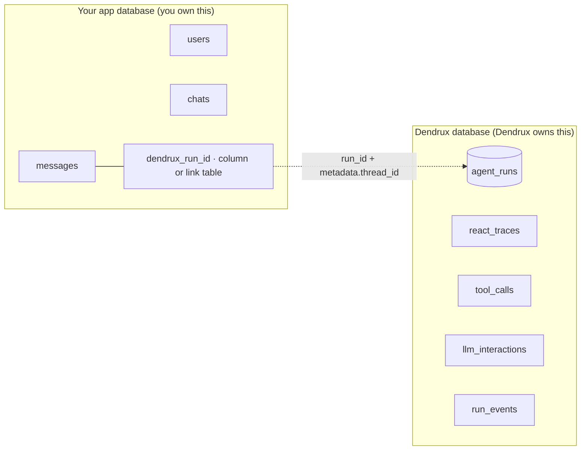

# Your app DB vs the Dendrux DB

If you are building a real product on top of Dendrux (a chatbot, an assistant, a workflow tool), the first question is almost always: where does my data go? You already have your own tables for users and conversations. Dendrux also writes tables. Knowing which side owns what is the difference between a clean integration and a painful one.

The short answer: **Dendrux owns run state and the audit trail. You own everything your product shows to a user.** They are two separate databases, linked by one ID.

## The two databases



Your tables hold product truth: who the user is, which conversations exist, what each message says, what the UI renders. Dendrux's [six tables](/docs/architecture/state-persistence) hold execution truth: every LLM call, every tool invocation, the ordered event log, and the pause state needed to resume. The two meet at a single point: the **run ID** that your turn records (a column on the message or a row in a link table), plus the `metadata.thread_id` you stamp on every run.

> **The boundary rule.** Do not use Dendrux tables as your product chat database. Store product-visible chats and messages in your own tables. Link to Dendrux using run IDs and run metadata. Treat the Dendrux schema as an internal, append-only audit surface that you read through `RunStore`, never write to directly.

## A minimal ChatGPT-style schema

There are two ways to link your product data to Dendrux, and which you pick is a real design decision. Both keep the boundary intact (your tables own product truth, Dendrux owns execution truth); they differ only in how the link is modeled. Every chat app starts with the same two tables:

```sql
CREATE TABLE chats (
    id       TEXT PRIMARY KEY,        -- your ID format (ULID/UUID)
    user_id  TEXT NOT NULL,
    title    TEXT,
    created_at TIMESTAMPTZ DEFAULT now()
);

CREATE TABLE messages (
    id        TEXT PRIMARY KEY,
    chat_id   TEXT NOT NULL REFERENCES chats(id),
    role      TEXT NOT NULL,          -- 'user' | 'assistant'
    content   TEXT,                   -- nullable while an assistant turn streams
    created_at TIMESTAMPTZ DEFAULT now()
);
```

### Pattern A: a run-ID column on messages (simplest)

Add `dendrux_run_id` (and a `status`) to the assistant message. That one column is the entire link back to Dendrux.

```sql
ALTER TABLE messages
    ADD COLUMN status         TEXT NOT NULL DEFAULT 'complete',  -- 'pending' | 'streaming' | 'complete' | 'error'
    ADD COLUMN dendrux_run_id TEXT;                              -- set on assistant messages; links to agent_runs.id
```

This is the right call for a prototype or a linear chat where one assistant message is produced by exactly one run and there is no regenerate. One lookup, no joins.

### Pattern B: an agent_run_links turn table (production)

Model the **turn** as its own entity: one row ties together a user message, the assistant message it produced, and the run that connected them.

```sql
CREATE TABLE agent_run_links (
    id                   TEXT PRIMARY KEY,
    chat_id              TEXT NOT NULL REFERENCES chats(id),
    user_message_id      TEXT NOT NULL REFERENCES messages(id),
    assistant_message_id TEXT REFERENCES messages(id),   -- null while pending; set once the answer row exists
    dendrux_run_id       TEXT UNIQUE,                     -- null until the run starts; unique so a run links to one turn
    status               TEXT NOT NULL DEFAULT 'pending', -- the TURN lifecycle lives here, not on the message
    created_at           TIMESTAMPTZ NOT NULL DEFAULT now(),
    updated_at           TIMESTAMPTZ NOT NULL DEFAULT now()
);

CREATE INDEX idx_agent_run_links_chat ON agent_run_links(chat_id);
```

Why this is the better shape for a real product:

- **Regenerate falls out for free.** Keep one user message, produce a new assistant message from a new run, and you simply get a second link row sharing `user_message_id`. The invariants "one user message maps to one run" and "one assistant message is produced by one run" both still hold per row. Edit-and-rerun and retries behave the same way: a new row, the old one preserved, with a clean per-turn audit.
- **Status lives in the right place.** The turn lifecycle (`pending` to `streaming` to `complete` or `error`) is a property of the linkage, not of the message content. Keeping it on the link row lets your `messages` rows stay as pure content.
- **Your `messages` table carries zero Dendrux columns.** All coupling to Dendrux is isolated in this one table, which is exactly the boundary this page is about.

Two modeling notes. Pick a single owner for turn status (the link row, not also the message) so they cannot drift. And decide whether `assistant_message_id` is nullable: if you create the assistant placeholder up front, as the lifecycle below does, it can be `NOT NULL`; if you create the link while still `pending` before any answer row exists, keep it nullable. `dendrux_run_id` stays null until the run starts and is `UNIQUE` so a run can never be double-linked; set it the moment you have it, which is immediately from `stream().run_id`, before the first token.

### Which to use

- **Prototype or linear chat, one answer per turn** leans to Pattern A: fewer tables, fewer joins.
- **A real product with regenerate, edit, retries, per-turn analytics, or strict message immutability** leans to Pattern B. It is a fine default for that tier.

## What not to store

The mistakes below all come from blurring the boundary. Avoid them:

- **Do not duplicate `tool_calls` into your `messages` table.** Tool invocations, their params, and results already live in Dendrux. If your UI needs to show "called the refund tool," read it from `RunStore.get_tool_invocations(run_id)`, do not re-persist it.
- **Do not store raw provider payloads in your app DB** unless you have a specific product reason. The full Anthropic/OpenAI request and response are already preserved verbatim in `llm_interactions`. Copying them into your tables just duplicates a large audit record you do not own.
- **Do not query `react_traces` as your user-facing transcript.** That table is the message history Dendrux ships to the model, in model-shaped form (tool roles, placeholder PII, internal ordering). Your transcript is your own `messages` rows, which you control and can render exactly as the user should see them.
- **Do not write to any Dendrux table.** It is append-only and owned by the runtime. Read through `RunStore` through your own routes.

## Dendrux does not reconstruct your conversation

This is the single most important thing to internalize, because it is easy to assume the opposite.

> Dendrux does not automatically rebuild your next chat turn from previous runs. Your app loads the prior turns from your `messages` table and passes them in via `history=`.

Each `agent.run()` is one turn. Dendrux reads the `history=` you give it as input and does not persist it back as your conversation (it only records the new turn's execution into its own tables). So the loop is always: load prior turns from your DB, convert to `ChatMessage`, run, then save the new user message and the assistant answer back to your DB. See [Chatbot threads](/docs/recipes/chatbot-threads) for the `history=` and `ChatMessage` mechanics.

## The request lifecycle for one turn

Here is the full path of a single chat message in a streaming app. The run ID is available immediately from the stream (before the first token), so you can link the assistant message at creation time and fill its content as the stream completes.

```python
@app.post("/chats/{chat_id}/messages")
async def post_message(chat_id: str, body: NewMessage, user: User = Depends(auth)):
    # 1. Load the PREVIOUS turns from YOUR db, before saving the new message,
    #    and convert them to Dendrux's input type. history is the earlier
    #    transcript only; the current message goes in user_input, never in both.
    rows = await db.load_messages(chat_id)
    history = [
        ChatMessage.user(m.content) if m.role == "user" else ChatMessage.assistant(m.content)
        for m in rows
        if m.status == "complete"
    ]

    # 2. Persist the user's message in YOUR db.
    turn_id = await db.save_message(chat_id, role="user", content=body.text, status="complete")

    # 3. Start the run. run_id is available before iteration. The idempotency
    #    key makes a retried HTTP request return the same run instead of a new one.
    stream = agent.stream(
        user_input=body.text,
        history=history,
        tenant_id=user.org_id,
        idempotency_key=f"turn-{turn_id}",
        metadata={"thread_id": chat_id, "user_id": user.id, "app_turn_id": turn_id},
    )

    # 4. Create the assistant placeholder linked to the run up front.
    assistant_id = await db.save_message(
        chat_id, role="assistant", content=None,
        status="streaming", dendrux_run_id=stream.run_id,
    )

    # 5. Stream tokens to the client. Text written before a tool call
    #    ("Let me look that up...") is commentary, not the answer.
    async def emit():
        async with stream:
            async for event in stream:
                if event.type == RunEventType.TEXT_DELTA:
                    yield sse({"iteration": event.iteration, "text": event.text})
                elif event.phase == "commentary":
                    yield sse({"iteration": event.iteration, "phase": "commentary"})
        # 6. Persist the final answer (never the concatenated deltas) to YOUR db.
        result = stream.result
        await db.update_message(
            assistant_id,
            content=result.answer if result else None,
            status="complete" if result and result.status == "success" else "failed",
        )

    return StreamingResponse(emit(), media_type="text/event-stream")
```

Do not build the stored answer by concatenating every `TEXT_DELTA`: a tool-using run streams narration from earlier steps too, and that text would end up in the saved message. `stream.result.answer` is the final answer only; `stream.result.commentary` holds the narration if you want to store it separately. The client can use the `iteration` / `phase` fields the same way to render narration as progress (see [Commentary vs final answer](/docs/reference/agent#commentary-vs-final-answer)).

The non-streaming version is the same shape with `await agent.run(...)` in place of the stream, saving `result.answer` and `result.run_id` after it returns.

The example above uses Pattern A (the run ID and status on the assistant message). With Pattern B, the steps are identical except the run ID and status live on a turn row instead: at step 4 insert an `agent_run_links` row (`user_message_id`, the freshly created `assistant_message_id`, `dendrux_run_id=stream.run_id`, `status='streaming'`), and at step 6 update that link row's status to `complete` while writing the answer to the plain `messages` row. Same choreography, one extra row write, and your `messages` table stays free of Dendrux columns.

## The history rule

`history=` is the transcript **before** this turn. `user_input=` is **this** turn. Never put the current message in both: the model would see it twice, and the cached prefix would change on every retry.

The most common way to break the rule is to save the new user message and then reload "all messages in the chat" to build `history`. Load first, or exclude the row you just wrote, as the lifecycle above does. A small conversion helper keeps it in one place:

```python
def to_history(rows) -> list[ChatMessage]:
    return [
        ChatMessage.user(m.content) if m.role == "user" else ChatMessage.assistant(m.content)
        for m in rows
        if m.status == "complete" and m.content    # skip failed or still-streaming turns
    ]
```

Skip assistant rows whose turn failed or is still streaming: a half-written or empty answer in the history teaches the model nothing useful. See [Chatbot threads](/docs/recipes/chatbot-threads#history-is-the-previous-transcript-only).

## Mapping run status to your product status

`RunResult.status` (and `RunDetail.status`) is the runtime's view. Your UI wants a smaller set. One adapter, in your code, keeps the two apart:

| Dendrux status | Product status | Notes |
| --- | --- | --- |
| `pending` | `pending` | Created, not yet running |
| `running` | `running` | |
| `waiting_client_tool` | `running` (or "waiting for the app") | Your client must execute a tool and submit the result |
| `waiting_human_input` | `needs_input` | Show the question; answer with `submit_input` |
| `waiting_approval` | `needs_approval` | Show the pending calls; decide with `submit_approval` |
| `paused` | `paused` | Requested or budget pause; continue with `submit_resume` |
| `success` | `completed` | Check `result.truncated`: a cut-off answer is still `success` |
| `max_iterations` | `failed` (reason: "too many steps") | The loop hit its cap without a final answer |
| `error` | `failed` | Show a generic message; the cause is in `result.error_info` and `RunDetail.error_info` |
| `cancelled` | `cancelled` | |

```python
PRODUCT_STATUS = {
    "pending": "pending", "running": "running",
    "waiting_client_tool": "running", "waiting_human_input": "needs_input",
    "waiting_approval": "needs_approval", "paused": "paused",
    "success": "completed", "max_iterations": "failed",
    "error": "failed", "cancelled": "cancelled",
}
```

## When a turn fails

Create the assistant placeholder before the run starts (as in the lifecycle above) and give it a failed state, so the user never sees a spinner that never ends. On `error`, store your own short message ("Something went wrong, try again") and keep the Dendrux `run_id` on the turn so support can find the audit trail. For a retryable error (`result.error_info.retryable`), offer a retry button that calls `agent.retry(run_id)`; for a refusal or content filter, show the product message you choose rather than the provider's. Do not show `result.error` verbatim: since 0.5.0 it is a fixed, safe summary, but it is still not written for end users. Details: [Handling provider errors](/docs/recipes/handling-provider-errors).

## Production smoke test

Run this once after every deploy of the integration, in staging first:

1. **App migrations.** Apply your own schema changes.
2. **Dendrux migrations.** Run `dendrux db migrate`, then `dendrux db check` (exit code 0 means current). A Postgres database that was not migrated fails at startup with `SchemaOutOfDateError`.
3. **Start the app.** Check the log for `FutureWarning`s about 0.6 defaults.
4. **Create a chat** in your UI or API.
5. **Send a message** and wait for the answer. Send a second message that depends on the first, to prove `history=` works.
6. **Inspect your transcript.** Your `messages` rows should hold the user text and the assistant answer, and the turn row should hold the `dendrux_run_id`.
7. **Inspect the Dendrux run.** `RunStore.get_run(run_id, tenant_id=...)` should show `success`, the right `tenant_id`, your `thread_id` and `app_turn_id` in `meta`, and token usage. `get_events` should show `run.started` through `run.completed`; `get_llm_calls` should show the model you expect.
8. **Check isolation.** Ask for the same `run_id` with a different tenant; you should get `None` or a 404, never data.
9. **Retry the request.** Re-send step 5's request with the same idempotency key; you should get the same `run_id`, not a second run.

## Recommended metadata keys

`metadata` is opaque JSON that lands on the run row. Dendrux stores it and never reads it during execution; it exists purely for your dev-side queries and rollups. For a production app, stamp every run with:

```python
metadata={
    "thread_id": str(chat_id),     # the conversation; the canonical chatbot key
    "user_id": str(user_id),       # who asked
    "tenant_id": str(tenant_id),   # for your own metadata_filter queries (not the isolation field)
    "app_turn_id": str(turn_id),   # the turn row in your agent_run_links table
    "request_id": request_id,      # ties a run to your HTTP/trace logs
}
```

Isolation between tenants is the separate `tenant_id=` argument on `run()` and every other call, not a metadata key; pass both. Keys are restricted to `[A-Za-z0-9_-]+` for filter safety (so a key like `dendrux.x`, which is reserved for Dendrux's own metadata, is rejected). Metadata is capped at 64 KiB. With these in place you can answer "every run in this chat," "this user's cost this month," or "the run behind request X" without touching your own tables. The query mechanics are in [Chatbot threads](/docs/recipes/chatbot-threads#querying-every-run-in-a-thread).

## Read through the public APIs, not raw SQL

When you need Dendrux's execution data (for a cost view, a debug panel, a per-thread inspector), reach for the public read surface rather than writing SQL against the tables:

- **`RunStore`** for programmatic reads: `list_runs(metadata_filter=...)`, `get_events`, `get_llm_calls`, `get_tool_invocations`, `get_traces`, `get_pauses`.
- **[Developer-owned routes](/docs/recipes/build-your-own-read-routes)** to expose those same reads over HTTP and SSE for a frontend.

Direct table queries are reasonable only for advanced internal debugging. For anything your product depends on, use the APIs: they are the stable contract, the schema is not.

## Where this fits

- Architecture: [State persistence](/docs/architecture/state-persistence) explains what each of Dendrux's six tables holds.
- Recipes: [Chatbot threads](/docs/recipes/chatbot-threads) for `history=`, `ChatMessage`, and `metadata_filter` queries.
- Recipes: [Build your own read routes](/docs/recipes/build-your-own-read-routes) to serve run data to your frontend.
